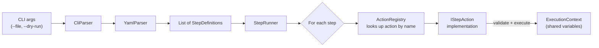

# YAML-Based Action Runner CLI

A robust, extensible C# .NET 10 CLI tool that parses YAML workflow files and executes steps sequentially or concurrently, featuring variable interpolation, dynamic expression evaluation, resilient error handling, and modular sub-workflow composition.

---

## Table of Contents

- [Quick Start](#quick-start)
  - [Prerequisites](#prerequisites)
  - [Build](#build)
  - [Run](#run)
- [CLI Options](#cli-options)
  - [Exit Codes](#exit-codes)
- [Architecture at a Glance](#architecture-at-a-glance)
  - [How a Workflow Executes](#how-a-workflow-executes)
  - [Key Design Patterns](#key-design-patterns)
- [YAML Workflow Format](#yaml-workflow-format)
  - [Variable Interpolation](#variable-interpolation)
- [Supported Actions](#supported-actions)
  - [Core Actions](#core-actions)
    - [1. `log`](#1-log--log-a-message)
    - [2. `delay`](#2-delay--wait-duration)
    - [3. `assert`](#3-assert--evaluate-condition)
    - [4. `http`](#4-http--http-request)
    - [5. `set-var`](#5-set-var--set-variable)
    - [6. `print-var`](#6-print-var--print-variable)
  - [Bonus Actions](#bonus-actions)
    - [7. `parallel`](#7-parallel--concurrent-execution)
    - [8. `retry`](#8-retry--resilient-retries)
    - [9. `shell`](#9-shell--execute-system-commands)
    - [10. `condition`](#10-condition--conditional-branching)
    - [11. `import`](#11-import--modular-workflow-reuse)
- [Example Workflows](#example-workflows)
- [Testing & Code Coverage](#testing--code-coverage)
  - [Running Tests](#running-tests)
  - [Viewing Code Coverage in Terminal](#viewing-code-coverage-in-terminal)
  - [Coverage Breakdown](#coverage-breakdown)
- [Design & Architecture Deep-Dive](#design--architecture-deep-dive)
  - [Component Reference Table](#component-reference-table)
  - [Extensibility (Adding New Actions)](#extensibility-adding-new-actions)
  - [Fail-Fast Execution Flow](#fail-fast-execution-flow)

---

## Quick Start

### Prerequisites

- [.NET 10 SDK](https://dotnet.microsoft.com/download/dotnet/10.0) (v10.0 or higher)

### Build

```bash
dotnet build
```

### Run

```bash
# Run a basic workflow
dotnet run --project src/YamlCLI -- --file examples/basic.yaml

# Run with verbose output (shows timing and internal details)
dotnet run --project src/YamlCLI -- --file examples/basic.yaml --verbose

# Dry-run mode (parses and validates steps without execution)
dotnet run --project src/YamlCLI -- --file examples/basic.yaml --dry-run

# Show help menu
dotnet run --project src/YamlCLI -- --help
```

---

## CLI Options

| Option | Shorthand | Description |
|---|---|---|
| `--file <path>` | `-f <path>` | **(Required)** Path to the YAML workflow file |
| `--dry-run` | | Validates and displays parsed steps without executing them |
| `--verbose` | `-v` | Enables detailed step execution logs and millisecond timers |
| `--help` | `-h` | Displays CLI usage instructions and available actions |

### Exit Codes

| Exit Code | Meaning |
|---|---|
| `0` | All executed steps succeeded |
| `1` | One or more steps failed, an assertion failed, or a file/parsing error occurred |

---

## Architecture at a Glance

Before diving into the action reference below, here is a quick overview of how the system is designed—and *why*. Understanding these four ideas makes the entire codebase predictable:

### How a Workflow Executes



1. **`CliParser`** reads command-line flags and produces a typed `CliArguments` object.
2. **`YamlParser`** reads the `.yaml` file and converts it into a flat list of `StepDefinition` objects (including nested sub-steps for actions like `parallel` or `condition`).
3. **`StepRunner`** iterates the list sequentially. For every step it asks the **`ActionRegistry`**: *"give me the handler for action type `X`"*.
4. The registry returns the matching **`IStepAction`** implementation (e.g. `LogAction`, `HttpAction`). The action validates its properties and executes.
5. All actions share a single **`ExecutionContext`**—a thread-safe variable store that supports `${varName}` interpolation.

### Key Design Patterns

| Pattern | Where it's used | What it gives you |
|---|---|---|
| **Strategy Pattern** | Every action (`log`, `http`, `retry`, …) implements the same `IStepAction` interface. The runner doesn't know *which* action it's calling—it just calls `ExecuteAsync`. | Actions are fully **interchangeable** and **independently testable**. Adding a new action doesn't touch any existing code. |
| **Reflection-based Auto-Discovery** | `ActionRegistry` scans the assembly at startup for every class that implements `IStepAction` and registers it automatically. | **Zero boilerplate**: create a class, build the project, and your action is available in YAML. No manual registration needed. |
| **Strict Schema Validation** | Each action declares an `AllowedProperties` set. Before execution, unknown or mistyped YAML keys are rejected with a clear error listing valid properties. | **No silent failures**: a typo like `dealy: 500` is caught immediately instead of being silently ignored. Even `--dry-run` validates schemas. |
| **Thread-Safe Shared State** | `ExecutionContext` uses a `ConcurrentDictionary` so parallel steps can read/write variables safely. | `parallel` action works correctly without any special synchronization in user workflows. |
| **Fail-Fast Execution** | If any step throws an exception, the runner stops immediately and reports succeeded / failed / skipped counts. | Errors surface early with a clear summary instead of cascading through subsequent steps. |
| **Dependency Injection via Factories** | `ActionRegistry.RegisterFactory("http", () => new HttpAction(mockClient))` lets tests inject mock dependencies. | Actions like `HttpAction` can be tested with fake HTTP responses without hitting the network. |

> **In short:** you can add a new action by creating one `.cs` file with ~15 lines of code. No registration, no wiring, no changes to existing files. The runner will find it, validate its YAML properties, and execute it.

---

## YAML Workflow Format

Every workflow file contains a top-level `steps` list:

```yaml
steps:
  - action: <action-name>
    <property>: <value>
```

### Variable Interpolation

Variables stored in the execution context can be referenced inside strings using `${varName}`:

```yaml
steps:
  - action: set-var
    name: greeting
    value: "Hello, World!"

  - action: log
    message: "Message is: ${greeting}"
```

Variables are case-insensitive and thread-safe.

---

## Supported Actions

### Core Actions

#### 1. `log` — Log a message

Prints a message to the console with variable interpolation.

```yaml
- action: log
  message: "Current endpoint: ${baseUrl}"
```

| Property | Required | Type | Description |
|---|---|---|---|
| `message` | ✓ | `string` | Text to display. Supports `${var}` interpolation. |

#### 2. `delay` — Wait duration

Asynchronously pauses execution without blocking threads.

```yaml
- action: delay
  duration: 500
```

| Property | Required | Type | Description |
|---|---|---|---|
| `duration` | ✓ | `integer` | Wait duration in milliseconds. Must be $\ge 0$. |

#### 3. `assert` — Evaluate condition

Evaluates an arithmetic, comparison, or boolean expression. Execution stops if the assertion evaluates to `false`.

```yaml
- action: assert
  condition: "1 + 2 == 3"

- action: assert
  condition: "${statusCode} == 200"
```

| Property | Required | Type | Description |
|---|---|---|---|
| `condition` | ✓ | `string` | Expression to evaluate using Dynamic LINQ (e.g. `==`, `!=`, `<`, `>`, `<=`, `>=`, `&&`, `\|\|`). |

#### 4. `http` — HTTP request

Sends an HTTP `GET` or `POST` request with JSON support and variable capturing.

```yaml
- action: http
  method: GET
  url: "https://jsonplaceholder.typicode.com/posts/1"
  save-status: postStatus
  save-body: postBody

- action: http
  method: POST
  url: "https://jsonplaceholder.typicode.com/posts"
  body: '{"title": "foo", "body": "bar", "userId": 1}'
  save-status: createStatus
```

| Property | Required | Type | Description |
|---|---|---|---|
| `method` | ✓ | `string` | HTTP method: `GET` or `POST`. |
| `url` | ✓ | `string` | Target endpoint. Supports `${var}` interpolation. |
| `body` | Optional | `string` | JSON payload for `POST` requests. |
| `save-status` | Optional | `string` | Context variable to save the integer HTTP status code. |
| `save-body` | Optional | `string` | Context variable to save the response body string. |

#### 5. `set-var` — Set variable

Stores a variable in memory for subsequent steps.

```yaml
- action: set-var
  name: apiUrl
  value: "https://api.example.com"
```

| Property | Required | Type | Description |
|---|---|---|---|
| `name` | ✓ | `string` | Variable name. |
| `value` | ✓ | `any` | Value to store. Supports `${var}` interpolation. |

#### 6. `print-var` — Print variable

Outputs the current value of a variable stored in context.

```yaml
- action: print-var
  name: apiUrl
```

| Property | Required | Type | Description |
|---|---|---|---|
| `name` | ✓ | `string` | Name of the variable to display. Throws if not defined. |

---

### Bonus Actions

#### 7. `parallel` — Concurrent execution

Runs multiple child steps in parallel using `Task.WhenAll`. Shared variables are backed by a thread-safe `ConcurrentDictionary`.

```yaml
- action: parallel
  steps:
    - action: log
      message: "Worker A starting"
    - action: log
      message: "Worker B starting"
    - action: delay
      duration: 200
```

| Property | Required | Type | Description |
|---|---|---|---|
| `steps` | ✓ | `list` | List of step definitions to execute concurrently. |

#### 8. `retry` — Resilient retries

Retries a step or a list of steps up to $N$ times upon failure with optional delay.

```yaml
- action: retry
  attempts: 3
  delay-ms: 500
  step:
    action: http
    method: GET
    url: "https://api.example.com/health"
```

| Property | Required | Type | Description |
|---|---|---|---|
| `attempts` | Optional | `integer` | Max attempts (default: `3`). |
| `delay-ms` | Optional | `integer` | Wait duration in milliseconds between retries (default: `0`). |
| `step` | ✓ | `step` or `list` | Step(s) to execute with retry protection. |

#### 9. `shell` — Execute system commands

Executes a command using the system shell (`cmd.exe` on Windows, `/bin/sh` on Unix) and captures standard output and exit codes.

```yaml
- action: shell
  command: "git rev-parse --short HEAD"
  capture-var: gitHash
  capture-exit-code: gitExit
```

| Property | Required | Type | Description |
|---|---|---|---|
| `command` | ✓ | `string` | Shell command to execute. Supports `${var}` interpolation. |
| `capture-var` | Optional | `string` | Variable name to store standard output. |
| `capture-exit-code` | Optional | `string` | Variable name to store exit code. |
| `working-dir` | Optional | `string` | Working directory for command execution. |
| `ignore-error` | Optional | `boolean` | If `true`, does not fail if exit code is non-zero (default: `false`). |

#### 10. `condition` — Conditional branching

Evaluates expressions and runs the `then` branch if true, or the optional `else` branch if false.

```yaml
- action: condition
  if: "${statusCode} == 200"
  then:
    - action: log
      message: "Request succeeded!"
  else:
    - action: log
      message: "Request failed with code ${statusCode}"
```

| Property | Required | Type | Description |
|---|---|---|---|
| `if` | ✓ | `string` | Expression to evaluate. |
| `then` | ✓ | `step` or `list` | Step(s) to execute if condition is true. |
| `else` | Optional | `step` or `list` | Step(s) to execute if condition is false. |

#### 11. `import` — Modular workflow reuse

Imports and executes steps from an external YAML workflow file within the current context. Relative paths resolve against the importing YAML file's directory.

```yaml
- action: import
  file: "sub-workflow.yaml"
```

| Property | Required | Type | Description |
|---|---|---|---|
| `file` | ✓ | `string` | Path to target YAML workflow file. |

---

## Example Workflows

The `examples/` directory contains sample workflows ready to run:

| Workflow File | Description | Command |
|---|---|---|
| **[`basic.yaml`](examples/basic.yaml)** | Core workflow demonstration (variables, delays, assertions) | `dotnet run --project src/YamlCLI -- --file examples/basic.yaml` |
| **[`http-example.yaml`](examples/http-example.yaml)** | HTTP GET/POST calls, JSON payload, and status assertions | `dotnet run --project src/YamlCLI -- --file examples/http-example.yaml` |
| **[`bonus-actions.yaml`](examples/bonus-actions.yaml)** | Complete showcase of all 5 bonus actions in action | `dotnet run --project src/YamlCLI -- --file examples/bonus-actions.yaml` |
| **[`sub-workflow.yaml`](examples/sub-workflow.yaml)** | Modular sub-workflow imported by `bonus-actions.yaml` | (Imported automatically) |

---

## Testing & Code Coverage

The solution contains **147 automated tests** across 6 test classes with **100% pass rate**:

| Test Class | Tests | Focus Area |
|---|---|---|
| [`YamlParserTests.cs`](tests/YamlCLI.Tests/YamlParserTests.cs) | 19 | Valid/invalid YAML structures, nested steps list/single, mapping/scalar values, error cases |
| [`ActionTests.cs`](tests/YamlCLI.Tests/ActionTests.cs) | 40 | Core actions, constructor & collision validation, architectural compliance, StepDefinition & ExecutionContext edge cases |
| [`BonusActionTests.cs`](tests/YamlCLI.Tests/BonusActionTests.cs) | 43 | Bonus actions (`parallel`, `retry`, `shell`, `condition`, `import`), dry-run, verbose, working-dir, strict schema property validation |
| [`StepRunnerTests.cs`](tests/YamlCLI.Tests/StepRunnerTests.cs) | 20 | Sequential execution, fail-fast on error/unexpected exceptions, dry-run, verbose output, summary reporting |
| [`CliArgumentTests.cs`](tests/YamlCLI.Tests/CliArgumentTests.cs) | 18 | CLI argument parsing, flags, help menu, exit codes, `Program.Main` and `RunAsync` execution |
| [`ConsoleWriterTests.cs`](tests/YamlCLI.Tests/ConsoleWriterTests.cs) | 7 | Output formatting, headers, summaries, status colors |
| **Total** | **147** | **100% Passing** |

### Running Tests

```bash
# Standard test run
dotnet test

# Detailed test output
dotnet test --verbosity normal
```

### Viewing Code Coverage

**1. Terminal Summary (Colorized ASCII breakdown):**
```powershell
powershell -ExecutionPolicy Bypass -File scripts/coverage.ps1
```

**2. Interactive Browser UI (Visual Line-by-Line Report):**
```powershell
powershell -ExecutionPolicy Bypass -File scripts/coverage.ps1 -Html
```
*(Runs the test suite, generates an interactive HTML dashboard in `coverage/index.html`, and automatically opens it in your default browser).*

**Terminal Output Preview:**
```text
===========================================================================
Class / Component                   |  Total Lines |    Covered |   Coverage %
---------------------------------------------------------------------------
Actions.ActionRegistry              |           69 |         69 |       100.0%
Actions.AssertAction                |           16 |         16 |       100.0%
Actions.ConditionAction             |           42 |         42 |       100.0%
Actions.DelayAction                 |           11 |         11 |       100.0%
Actions.HttpAction                  |           57 |         57 |       100.0%
Actions.ImportAction                |           32 |         32 |       100.0%
Actions.LogAction                   |           10 |         10 |       100.0%
Actions.ParallelAction              |           40 |         40 |       100.0%
Actions.PrintVarAction              |           10 |         10 |       100.0%
Actions.RetryAction                 |           55 |         55 |       100.0%
Actions.SetVarAction                |           12 |         12 |       100.0%
Actions.ShellAction                 |           81 |         81 |       100.0%
Actions.StepActionExtensions        |           11 |         11 |       100.0%
Execution.ConditionEvaluator        |           33 |         33 |       100.0%
Execution.ConsoleWriter             |           73 |         73 |       100.0%
Execution.StepExecutor              |           23 |         23 |       100.0%
Execution.StepRunner                |           71 |         71 |       100.0%
Models.CliArguments                 |            6 |          6 |       100.0%
Models.ExecutionContext             |           32 |         32 |       100.0%
Models.StepDefinition               |           46 |         46 |       100.0%
Models.StepExecutionException       |            2 |          2 |       100.0%
Parsing.CliParser                   |           68 |         68 |       100.0%
Parsing.YamlParser                  |           70 |         70 |       100.0%
Program                             |           62 |         62 |       100.0%
===========================================================================
OVERALL LINE COVERAGE   : 100% (932/932 lines)
OVERALL BRANCH COVERAGE : 89.3%
===========================================================================
```

---

## Design & Architecture Deep-Dive

This section supplements the [Architecture at a Glance](#architecture-at-a-glance) overview with the full component reference for developers working inside the codebase.

### Component Reference Table

| Component | Architectural Role | Key Responsibility |
|---|---|---|
| [`Program`](src/YamlCLI/Program.cs) | Composition Root | Wires CLI parsing → YAML parsing → runner. Contains zero business logic. |
| [`CliParser`](src/YamlCLI/Parsing/CliParser.cs) | Option Parser | Produces a typed [`CliArguments`](src/YamlCLI/Models/CliArguments.cs) from raw `string[] args`. |
| [`YamlParser`](src/YamlCLI/Parsing/YamlParser.cs) | Workflow Deserializer | YAML → `List<StepDefinition>` tree (handles nested sub-steps). |
| [`IStepAction`](src/YamlCLI/Actions/IStepAction.cs) | Strategy Interface | Contract: `ActionType` + `AllowedProperties` + `ExecuteAsync`. |
| [`ActionRegistry`](src/YamlCLI/Actions/ActionRegistry.cs) | Reflection Discovery + Factory DI | Auto-scans assemblies; supports `RegisterFactory` for test injection. |
| [`StepRunner`](src/YamlCLI/Execution/StepRunner.cs) | Top-Level Orchestrator | Sequential loop, fail-fast, timing, dry-run validation, summary output. |
| [`StepExecutor`](src/YamlCLI/Execution/StepExecutor.cs) | Nested Step Dispatcher | Executes child steps (for `parallel`, `retry`, `condition`, `import`). |
| [`ExecutionContext`](src/YamlCLI/Models/ExecutionContext.cs) | Thread-Safe State | `ConcurrentDictionary` variables, `${var}` interpolation, execution flags. |
| [`ConsoleWriter`](src/YamlCLI/Execution/ConsoleWriter.cs) | Console Abstraction | Testable formatted output (headers, colors, summaries). |
| [`ConditionEvaluator`](src/YamlCLI/Execution/ConditionEvaluator.cs) | Expression Engine | Dynamic LINQ evaluation with safe variable binding (no substring collisions). |

### Extensibility (Adding New Actions)

To add a custom action:

1. Create a class implementing [`IStepAction`](src/YamlCLI/Actions/IStepAction.cs) in `src/YamlCLI/Actions/`:
   ```csharp
   public class MyCustomAction : IStepAction
   {
       private static readonly HashSet<string> s_allowed = new(StringComparer.Ordinal) { "message" };

       public string ActionType => "my-custom";
       public IReadOnlySet<string> AllowedProperties => s_allowed;

       public async Task ExecuteAsync(StepDefinition step, ExecutionContext context)
       {
           this.Validate(step);
           var message = step.GetRequiredString("message");
           context.Console.Message($"Custom: {message}");
       }
   }
   ```
2. Build the project. The action is immediately auto-discovered via reflection and available in YAML files:
   ```yaml
   steps:
     - action: my-custom
       message: "Works out of the box!"
   ```

### Reflection Safety & Architectural Guardrails

While reflection enables a zero-boilerplate developer experience, unchecked reflection is prone to subtle runtime defects. The codebase mitigates these risks at two distinct defensive layers:

#### 1. Runtime Defensive Validation in `ActionRegistry`
- **Constructor Verification**: Checks for a public parameterless constructor before attempting instantiation. If a developer introduces an action requiring constructor arguments without a factory, `ActionRegistry` throws an actionable `InvalidOperationException` explicitly identifying the class and instructing how to resolve it.
- **Name Collision Detection**: Verifies that no two classes declare identical `ActionType` strings. Inadvertent collisions throw an exception at startup rather than silently overwriting another action.
- **Malformed ActionType Rejection**: Rejects null, empty, or whitespace action identifiers.
- **Contextual Exception Wrapping**: If an action fails during instantiation, the error is caught and wrapped with the target class name and inner exception details.

#### 2. CI/Build Architecture Tests
To prevent reflection defects from ever reaching production, [`ActionTests.cs`](tests/YamlCLI.Tests/ActionTests.cs) includes an automated architectural test (`AllStepActions_MeetArchitecturalStandards`) that runs on every build:
- Scans all non-abstract `IStepAction` implementations in the assembly.
- Asserts every action possesses a valid public parameterless constructor.
- Asserts every action instantiates cleanly without exceptions.
- Asserts all `ActionType` strings are unique, non-empty, and lowercase.
- Asserts all `AllowedProperties` sets are initialized and contain valid property names.

#### Scaling Considerations (100+ Actions)
For massive-scale platforms (hundreds of actions across multiple packages):
- **Runtime Reflection** provides zero-effort discovery and runtime plugin support (loading external `.dll` files via `AssemblyLoadContext`).
- **Roslyn Source Generators** offer a zero-runtime-cost compile-time alternative: detecting `IStepAction` classes during `dotnet build` and emitting static factory registrations directly, eliminating reflection entirely for sub-millisecond Native AOT startup.

### Fail-Fast Execution Flow

If any step throws an error or assertion failure, execution stops immediately. The runner reports the exact count of succeeded, failed, and skipped steps:

```text
───────────────────────────────────
  Result: FAILED
  Steps: 5/6 succeeded, 1 failed (1 skipped)
  Duration: 2156ms
───────────────────────────────────
```
